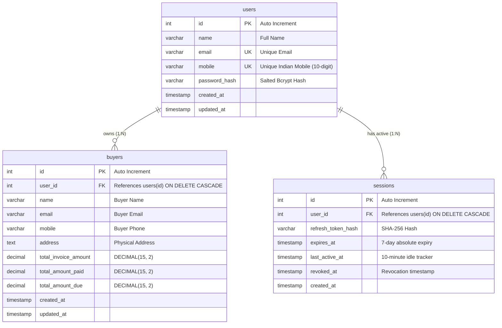

# Buyer Management Portal

A full-stack SaaS portal for managing buyers, importing invoices from spreadsheets (CSV, XLS, XLSX), tracking payments/balances, and multi-tenant user authentication.

### 🌐 Live Application & Demo Links
- **Frontend Application (Vercel)**: [https://buyer-management-portal.vercel.app](https://buyer-management-portal.vercel.app)
- **Backend REST API (Render)**: [https://buyer-management-portal.onrender.com](https://buyer-management-portal.onrender.com)
- **API Health Check**: [https://buyer-management-portal.onrender.com/api/health](https://buyer-management-portal.onrender.com/api/health)

---

## 🛠 Technology Stack

- **Frontend**: React 18, Vite, React Router v7, Axios, Vanilla CSS (Design Tokens & Responsive Grid)
- **Backend**: Node.js, Express.js (MVC Architecture)
- **Database**: MySQL 8.0+ (via `mysql2/promise` connection pool)
- **Authentication**: JWT access tokens (10m expiry), cryptographically random refresh tokens (SHA-256 hashed in database), HttpOnly cookies, idle session tracking (10m timeout)
- **File Ingestion**: Multer (5 MB RAM memory storage), `csv-parser` (streaming CSV), `xlsx` (Excel), atomic database transactions
- **Testing**: Node.js native test runner with custom assertions, Supertest

---

## 📂 Project Structure

```text
buyer_management_portal/
├── backend/
│   ├── src/
│   │   ├── config/          # MySQL database connection pool
│   │   ├── controllers/     # Auth and Buyer controllers
│   │   ├── middlewares/     # JWT authentication, file upload, and validation
│   │   ├── models/          # User, Buyer, and Session database models
│   │   ├── routes/          # RESTful auth and buyer routes
│   │   ├── services/        # File parser and spreadsheet row validator
│   │   └── server.js        # Express app entry point & port fallback logic
│   ├── test/                # Automated backend test suites
│   │   ├── authTest.js      # Auth, JWT, session rotation & revocation tests (14 tests)
│   │   ├── buyerUploadTest.js # Multipart upload, limits & rollback tests (14 tests)
│   │   └── buyerListTest.js # Search, pagination & user isolation tests (54 tests)
│   ├── .env.example         # Template for environment variables (clean placeholders)
│   ├── .env                 # Local backend environment variables (git-ignored)
│   └── package.json         # Backend dependencies & test scripts
│
├── frontend/
│   ├── src/
│   │   ├── api/             # Axios client with 401 silent token refresh & API helpers
│   │   ├── components/      # Responsive Navbar, Footer, and ProtectedRoute
│   │   ├── context/         # AuthContext provider & useAuth hook
│   │   ├── pages/           # LandingPage, SignUpPage, LoginPage, DashboardPage,
│   │   │                    # UploadPage, BuyerListPage, PlaceholderPage
│   │   ├── App.jsx          # Route tree configuration
│   │   ├── index.css        # Global CSS design system tokens
│   │   └── main.jsx         # React DOM root entry
│   ├── .env.example         # Template for frontend environment variables
│   ├── .env                 # Local frontend environment variables (git-ignored)
│   ├── vite.config.js       # Vite configuration with /api reverse proxy
│   └── package.json         # Frontend dependencies & build scripts
│
├── database/
│   ├── schema.sql           # Schema definition (users, buyers, sessions tables)
│   └── migrations/          # Incremental database migrations
│
├── .gitignore               # Root git ignore rules (ignores .env, dist, node_modules)
└── README.md                # Project documentation
```

---

## ⚙️ Prerequisites

- **Node.js**: v18.0.0 or higher
- **npm**: v9.0.0 or higher
- **MySQL Server**: v8.0 or higher running locally or remotely

---

## 🚀 Getting Started

### 1. Database Setup

Create the database and schema using MySQL client:
```bash
mysql -u root -p < database/schema.sql
```

The schema creates three core tables:
1. `users` — account credentials and contact details.
2. `sessions` — database-backed sessions with SHA-256 hashed refresh tokens, idle activity timestamps, and revocation markers.
3. `buyers` — user-isolated buyer records with monetary amounts (`total_invoice_amount`, `total_amount_paid`, `total_amount_due`).

#### Entity-Relationship (ER) Diagram



Files provided:
- [database/schema.sql](database/schema.sql) — local schema initialization with `CREATE DATABASE`.
- [database/schema_production.sql](database/schema_production.sql) — production schema for managed cloud databases (Aiven, RDS, PlanetScale).

---

### 2. Backend Setup

```bash
cd backend

# Install dependencies
npm install

# Copy environment variables template
cp .env.example .env
```

Ensure `backend/.env` contains your MySQL credentials and a secure JWT secret:
```env
PORT=5001
NODE_ENV=development
DB_HOST=localhost
DB_PORT=3306
DB_USER=root
DB_PASSWORD=your_mysql_password
DB_NAME=buyer_management_portal
JWT_SECRET=your_long_random_jwt_secret_key
JWT_EXPIRES_IN=10m
REFRESH_TOKEN_EXPIRES_IN=7d
SESSION_IDLE_TIMEOUT=10m
CLIENT_URL=http://localhost:5173
```

Start the backend:
```bash
npm run dev
```

> **Note on macOS / Port**: Port `5000` is reserved by AirPlay Receiver on macOS. `backend/.env` sets `PORT=5001` by default to avoid this conflict. The server also includes an automatic port-fallback mechanism if 5001 is also in use.

---

### 3. Frontend Setup

In a new terminal window:
```bash
cd frontend

# Install dependencies
npm install

# Copy environment variables template
cp .env.example .env
```

Ensure `frontend/.env` contains:
```env
# Uses Vite's built-in /api proxy (configured in vite.config.js) — no CORS issues in development
VITE_API_URL=/api
```

> **For production**: set `VITE_API_URL` to your deployed backend URL (e.g. `https://api.yourdomain.com/api`).

Start the Vite development server:
```bash
npm run dev
# Server runs on http://localhost:5173
```

---

## 🧪 Automated Testing

The backend includes 82 automated test assertions across three test suites:

```bash
cd backend

# Run the complete test suite (82 assertions)
npm test

# Run individual test suites
npm run test:auth    # 14 tests: registration, validation, login, JWT verification, session rotation & logout
npm run test:upload  # 14 tests: file formats, 5MB limit, row validation, atomic transaction rollback
npm run test:list    # 54 tests: pagination, multi-field search, user data isolation, SQL injection prevention
```

### Production Build Verification

```bash
cd frontend
npm run build
```
Builds production-ready static assets in `frontend/dist` without errors.

---

## 🔒 Security Architecture

1. **Password Hashing**: Salted bcrypt password hashing with 10 salt rounds.
2. **Access Tokens**: Short-lived (10-minute) JWT tokens passed as `Authorization: Bearer <token>`.
3. **Database-Backed Sessions**: Refresh tokens are 80-character cryptographically random strings stored as SHA-256 hashes in MySQL. Raw tokens are never logged or persisted in browser localStorage.
4. **Token Rotation**: Every refresh request atomically rotates the refresh token. Old tokens are immediately invalidated.
5. **Idle Timeout**: The server enforces a 10-minute idle session timeout based on `sessions.last_active_at`.
6. **HttpOnly Cookies**: Refresh tokens are set with `httpOnly: true`. In production (`NODE_ENV=production`), `secure: true` (HTTPS) and `sameSite: strict` are enforced.
7. **Multi-Tenant User Isolation**: All buyer queries and bulk uploads are scoped strictly to `req.user.userId`. Parameterized SQL queries prevent SQL injection and horizontal privilege escalation.
8. **Atomic Ingestion**: File uploads validate all rows before writing to MySQL within an explicit transaction. Any row failure aborts the transaction with zero records inserted.

---

## 🏆 Bonus Deliverables Completed

| Bonus Feature | Implementation Details | Location in Codebase |
|---|---|---|
| **Refresh Token Implementation** | Secure HttpOnly cookie-based refresh token with SHA-256 database hashing, automatic rotation on refresh, and 10-minute server-side idle timeout. | [sessionModel.js](backend/src/models/sessionModel.js), [authController.js](backend/src/controllers/authController.js) |
| **Clean Architecture (MVC Pattern)** | Strict separation of concerns across Models (database layer), Controllers (HTTP/request handling), Routes, Middlewares, and Services. | `backend/src/{models,controllers,routes,middlewares,services}` |
| **Proper Middleware & Error Handling** | JWT authentication guard, Multer file upload filter, input validators, normalized CORS policy, and centralized Express error handler. | [authMiddleware.js](backend/src/middlewares/authMiddleware.js), [errorHandler.js](backend/src/middlewares/errorHandler.js) |
| **Automated Testing Suite** | Comprehensive 82-assertion test suite covering Auth (14), Upload atomic transactions (14), and Buyer search/pagination/SQLi prevention (54). | [test/](backend/test/) |
| **Multi-Tenant User Isolation & RBAC** | Strict row-level user scoping on all buyer CRUD endpoints, preventing cross-tenant data leaks and unauthorized record access. | [buyerModel.js](backend/src/models/buyerModel.js), [buyerController.js](backend/src/controllers/buyerController.js) |

